  
  
  

I study whether **AI agents respond to the right causes** in the environments they act in. I design controlled interventions on an agent's world (hazard, information, social context, mobility) and test whether its behavior changes the way it should, and *only* when it should. World models and simulation-trained agents face the same question: does behavior follow the causal structure of the environment, or surface patterns?

I'm a PhD candidate in GIScience in the Spatial Climate Solutions Lab at UC Santa Barbara (expected 2027), working across geospatial science, machine learning, and applied AI.

## 🔭 Currently working on

**[SPARC-Evac](https://salami-mary.github.io/sparc-evac/)** asks whether LLM agents that simulate household evacuation respond to the right cues in the January 2025 Eaton Fire, using paired counterfactual tests grounded in hazards research. *Research in progress: full method and results coming with the paper. Watch this space.* · [Project page](https://salami-mary.github.io/sparc-evac/) · [Repo](https://github.com/Salami-Mary/sparc-evac)

## 🧭 Research themes

- **Agent behavior under controlled interventions:** counterfactual tests of whether LLM agents respond to the right environmental causes ([SPARC-Evac](https://salami-mary.github.io/sparc-evac/)).
- **Spatiotemporal behavior modeling:** hybrid HMM–LSTM segmentation of movement trajectories into behaviors; human movement during California wildfires from geotagged tweets.
- **Generative models and GPU computing:** GAN-based fashion image generation (AFRIGAN, NeurIPS 2021 workshop); deep-learning Earth-science workloads benchmarked on multi-GPU and multi-cloud platforms (*International Journal of Digital Earth*, 2023).

## 📰 News

| When | What |
|---|---|
| **Oct 2026** | Launched the [SPARC-Evac project page](https://salami-mary.github.io/sparc-evac/), with an interactive demo of the paired-test method |
| **2026** | Reviewer, NeurIPS 2026 Evaluations & Datasets Track |
| **2026** | Organizer, Climate Change AI Summer School 2026 |
| **Spring 2026** | Research intern at Direct Relief: post-wildfire recovery datasets for the 2025 Palisades Fire |
| **2025** | Workshop organizer, CLRLC at NeurIPS 2025 |
| **2025** | NSF GIScience Travel Award |

## 🧪 Selected projects

| Project | What it does | Built with |
|---|---|---|
| [**SPARC-Evac**](https://salami-mary.github.io/sparc-evac/) · 2026 | Counterfactual evaluation of LLM wildfire-evacuation agents (in progress) | Python, GeoPandas, LLM APIs |
| [**Trajectory segmentation**](https://github.com/Salami-Mary/Trajectory-Segmentation3) | Hybrid HMM–LSTM model that segments animal movement trajectories into behaviors | Python, hmmlearn, TensorFlow |
| [**Tweet trajectories**](https://github.com/Salami-Mary/Tweet-Trajectories-) | Tracing human movement during California wildfires from geotagged tweets | Python, Jupyter |
| [**African hairstyle detection**](https://github.com/Salami-Mary/Identifying-African-Hairstyles) | YOLOv5 detector for three African hairstyles, trained on ~800 annotated images | YOLOv5, Roboflow |
| [**Urban rooftop detection**](https://github.com/Salami-Mary/Urban-Rooftop-Detection-and-Modelling-) | Detecting and counting buildings in satellite imagery | Python, computer vision |

## 📄 Selected publications

- **AFRIGAN:** African fashion style generator using GANs. *NeurIPS 2021, Black in AI Workshop*
- **AFRIFASHION1600:** a contemporary African fashion dataset for computer vision. *CVPR 2021 Workshops*
- **COVNLP:** a multisource COVID-19 dataset for NLP. *AAAI 2022, Social Impact of AI for Africa Workshop*
- **Adopting GPU computing to support DL-based Earth science applications.** *International Journal of Digital Earth, 2023*

Full list on my [website](https://salami-mary.github.io/my-website/#publications).

## 🛠️ Tools

  
  
  
  
  
  
  
  
  
  
  
  
  
  
  

